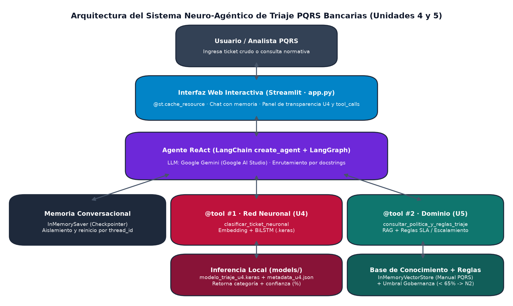
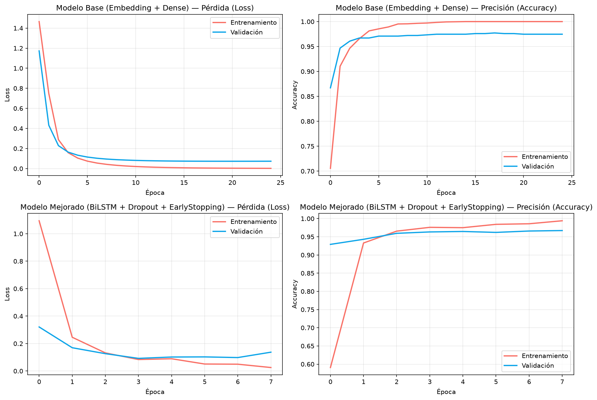
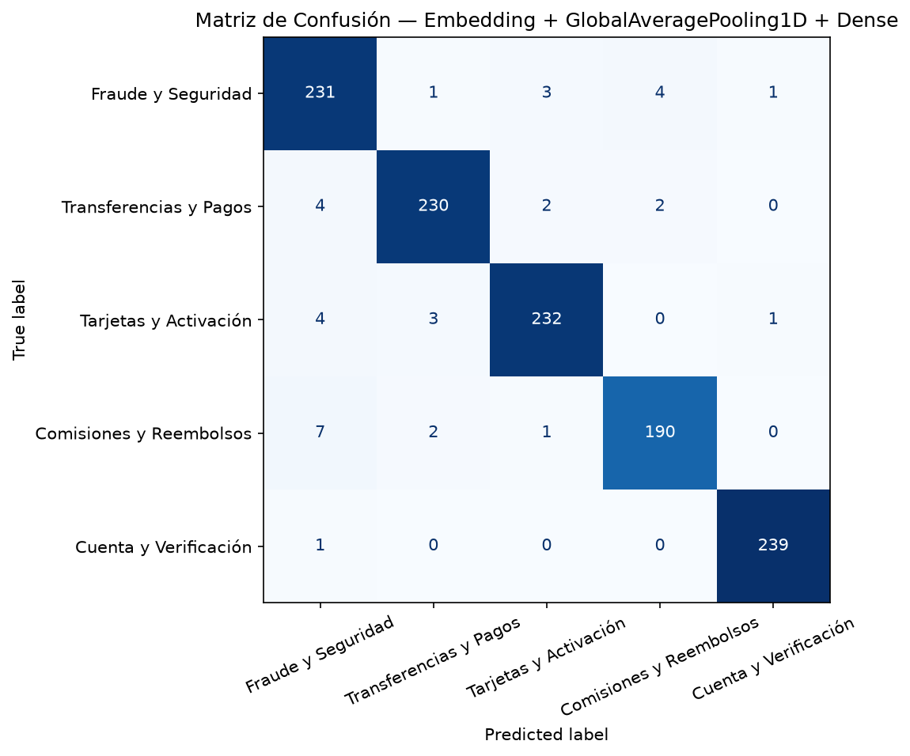

# Sistema Neuro-Agéntico de Triaje PQRS Bancarias (Unidades 4 y 5)

## Sección 1 — Identificación, Ruta y Propuesta de Valor

* **Título del Proyecto:** Sistema Neuro-Agéntico de Triaje Inteligente para PQRS y Tickets Bancarios
* **Integrantes:**
  * **Andres Plazas**
  * **Jersson Montenegro**
* **Asignatura:** Inteligencia Artificial — Universidad de Boyacá
* **Ruta Seleccionada:** **Ruta 3 — PLN con Embeddings + Agente de Triaje Inteligente**
* **Dataset Utilizado:** [`mteb/banking77`](https://huggingface.co/datasets/mteb/banking77) (Hugging Face), filtrando 30 intenciones reales de soporte bancario agrupadas en **5 colas operativas PQRS** (`Fraude y Seguridad`, `Transferencias y Pagos`, `Tarjetas y Activación`, `Comisiones y Reembolsos` y `Cuenta y Verificación`), con **3,949 tickets de entrenamiento** y **1,158 tickets de prueba** (respaldados localmente en `data/banking_pqrs_dataset.csv`).

### ¿Por qué combinar una Red Neuronal (Unidad 4) con un Agente (Unidad 5) en lugar de usar solo un LLM?

Resolver el triaje bancario enviando cada ticket crudo únicamente a un prompt de un LLM presenta tres problemas operativos concretos:
1. **Costo de tokens y latencia en alto volumen:** Nuestra red neuronal local (`models/modelo_triaje_u4.keras`, peso de apenas **0.93 MB**) clasifica tickets en milisegundos con **96.89% de precisión** y a costo **$0 de tokens** en la API.
2. **Probabilidad calibrada y gobernanza cuantitativa:** La capa `Softmax` de la red neuronal entrega una distribución numérica real por clase. Cuando la confianza cae por debajo del umbral de **65%** (como ocurrió en nuestro caso real de análisis de fallo `test_1663` con **45.58%**), el motor de reglas detecta objetivamente la incertidumbre y ordena escalamiento a un **Analista Humano Nivel 2**, algo que un LLM de texto libre no garantiza de forma determinista.
3. **Separación entre percepción y normativa cambiante:** Las políticas internas del banco (tiempos SLA, topes de reembolso provisional y exenciones de cuota de manejo) cambian con frecuencia. Al separar la clasificación perceptiva (`@tool #1`) de la base de conocimiento RAG + reglas (`@tool #2`), podemos actualizar políticas sin reentrenar la red neuronal.

### Distribución de Responsabilidades

| Integrante | Componentes Desarrollados |
| :--- | :--- |
| **Andres Plazas** | Curación y mapeo del dataset `mteb/banking77`, entrenamiento y comparación experimental en `notebooks/entrenamiento_u4.ipynb`, análisis de fallo real (`test_1663`), módulo `src/model_u4.py` y documentación de la Unidad 4. |
| **Jersson Montenegro** | Base de conocimiento RAG + motor de reglas SLA (`src/knowledge_base.py`), definición de `@tool #1` y `@tool #2` (`src/tools.py`), agente LangGraph con memoria (`src/agent_u5.py`), evaluación en `notebooks/evaluacion_agente_u5.ipynb` e interfaz interactiva en `app.py`. |

---

## Sección 2 — Arquitectura del Sistema (Diagrama Propio)

El sistema conecta la interfaz web de **Streamlit** (`app.py`) con un agente ReAct construido mediante `create_agent` y `InMemorySaver` (LangChain 1.x / LangGraph 1.x), orquestando la red neuronal entrenada en Keras (`@tool #1`) y la herramienta híbrida de RAG + reglas de escalamiento (`@tool #2`).



---

## Sección 3 — Ingeniería del Modelo de Red Neuronal (Unidad 4) y Análisis de un Fallo Real

### Preparación de Datos sin Fuga (*Data Leakage*)
En `notebooks/entrenamiento_u4.ipynb` se normalizaron los textos y se construyó el diccionario `word_to_index` (**1,609 tokens efectivos**, `MAX_LEN = 32`) **exclusivamente sobre los 3,949 ejemplos de entrenamiento**, evitando cualquier filtración estadística desde los 1,158 ejemplos del conjunto de prueba.

### Comparación Experimental de Arquitecturas

Se compararon dos arquitecturas con capa `Embedding(input_dim=1609, output_dim=48, mask_zero=True)` (usando `mask_zero=True` para que las capas posteriores ignoren el relleno `0`):

| Configuración | Arquitectura e Hiperparámetros | Épocas | Test Loss | Test Accuracy |
| :--- | :--- | :---: | :---: | :---: |
| **Modelo 1 (Base — Ganador)** | `Embedding(48)` → `GlobalAveragePooling1D` → `Dense(32, relu)` → `Dense(5, softmax)` · Adam (`lr=0.001`), `batch_size=32` | 25 | **0.0851** | **96.89%** |
| **Modelo 2 (Secuencial Regularizado)** | `Embedding(48)` → `SpatialDropout1D(0.25)` → `Bidirectional(LSTM(32, dropout=0.25))` → `Dense(32, relu)` → `Dropout(0.35)` → `Dense(5, softmax)` · Adam (`lr=0.002`) + `EarlyStopping(patience=4)` | 8 *(early stop)* | 0.1230 | 95.94% |

#### Hallazgo Experimental
Contrario a la intuición de que una red recurrente más pesada siempre mejora el desempeño, en tickets bancarios cortos (`MAX_LEN = 32` palabras) el modelo **Embedding + GlobalAveragePooling1D + Dense** logró menor pérdida de generalización (**0.0851 vs. 0.1230**) y mayor exactitud en prueba (**96.89% vs. 95.94%**) con un tamaño exportado de apenas **0.93 MB**. En secuencias breves con vocabulario de dominio altamente discriminativo, el promedio global sobre embeddings enmascarados presenta menor varianza que la `Bidirectional LSTM`. Por rigor experimental, seleccionamos el **Modelo 1** para producción (`models/modelo_triaje_u4.keras`).



### Desempeño por Categoría en Prueba (`n = 1,158`)

| Categoría PQRS | Precision | Recall | F1-Score | Support |
| :--- | :---: | :---: | :---: | :---: |
| Fraude y Seguridad | 0.9352 | 0.9625 | 0.9487 | 240 |
| Transferencias y Pagos | 0.9746 | 0.9664 | 0.9705 | 238 |
| Tarjetas y Activación | 0.9748 | 0.9667 | 0.9707 | 240 |
| Comisiones y Reembolsos | 0.9694 | 0.9500 | 0.9596 | 200 |
| Cuenta y Verificación | 0.9917 | 0.9958 | 0.9938 | 240 |
| **Accuracy Global** | — | — | **0.9689** | **1,158** |



### Análisis de un Fallo Real (*Error Analysis*)

Sobre las 1,158 muestras de prueba, el modelo cometió **36 errores (3.11%)**. Seleccionamos el fallo con menor confianza para analizar sus causas reales (salida guardada en la Celda 13 de `notebooks/entrenamiento_u4.ipynb`):

* **Identificador del dataset:** `test_1663` (índice `625` en el conjunto de prueba)
* **Texto real del ticket:** `"Can I still use the app if I switched phones?"`
* **Intención original en Banking77:** `lost_or_stolen_phone`
* **Valor real (etiqueta esperada):** `Fraude y Seguridad`
* **Predicción del modelo:** `Cuenta y Verificación`
* **Probabilidad de la clase predicha:** **45.58%** (`0.4558`)
* **Probabilidad asignada a la clase real (`Fraude y Seguridad`):** **34.09%** (`0.3409`)

**Diagnóstico del fallo:** El cliente no utiliza palabras asociadas a robo o pérdida (*"lost"*, *"stolen"*), sino términos propios de gestión de cuenta y acceso (*"use the app"*, *"switched phones"*). Al ser un caso genuinamente ambiguo sin contexto adicional, la capa `Softmax` distribuye la probabilidad principalmente entre `Cuenta y Verificación` (45.58%) y `Fraude y Seguridad` (34.09%). Este fallo justifica directamente la regla de gobernanza implementada en la Unidad 5: al caer por debajo del **65%**, el agente no cierra ni enruta automáticamente el ticket, sino que exige escalamiento a un **Analista Humano Nivel 2**.

---

## Sección 4 — Diseño del Agente y Matriz de Evaluación (Unidad 5)

### Diseño de las 2 Herramientas (`@tool`) y sus Docstrings

Siguiendo la arquitectura de **LangChain 1.x / LangGraph 1.x** (`create_agent`) vista en la Unidad 5 del curso:

1. **`@tool #1 — clasificar_ticket_neuronal(texto_ticket: str)`** (`src/tools.py`):
   * Envuelve la inferencia local de `models/modelo_triaje_u4.keras` (`src/model_u4.py`).
   * **Diseño del docstring:** Indica explícitamente al LLM cuándo usarla (*"SIEMPRE que el usuario proporcione el texto de un ticket, queja o solicitud de un cliente bancario"*) y cuándo abstenerse (*"NO la uses para saludos, preguntas generales ni consultas puras sobre políticas internas"*).
   * **Ahorro de tokens:** Retorna una sola línea compacta con categoría, confianza, nivel de certeza, bandera `<65%` y top-3 probabilidades, evitando enviar tensores o JSON extensos al contexto de Gemini.

2. **`@tool #2 — consultar_politica_y_reglas_triaje(categoria: str, confianza: float, consulta_normativa: str)`** (`src/tools.py` + `src/knowledge_base.py`):
   * Combina en una sola herramienta:
     * **Motor determinista de reglas de negocio:** Calcula prioridad, SLA oficial en horas, área responsable, tope de reembolso provisional y activa la alerta `ESCALAR A ANALISTA HUMANO NIVEL 2` cuando `confianza < 0.65`.
     * **RAG ligero vectorial:** Divide el manual de políticas con `RecursiveCharacterTextSplitter(chunk_size=380, chunk_overlap=45)` e indexa en `InMemoryVectorStore` usando `GoogleGenerativeAIEmbeddings(model="models/gemini-embedding-001")` (`dim=3072`), recuperando únicamente los `k=2` fragmentos más relevantes para cuidar el presupuesto de tokens.

### Memoria Conversacional (`InMemorySaver` + `thread_id`) y Gestión de Cuota API
* **Memoria:** Se configuró `InMemorySaver()` como `checkpointer` en `create_agent(...)`. En `notebooks/evaluacion_agente_u5.ipynb` se verificó que el hilo `eval-memoria-1` recuerda el nombre y cargo del analista entre turnos, mientras que un hilo nuevo (`eval-memoria-2`) mantiene aislamiento total. En `app.py`, el botón **Reiniciar conversación** genera un nuevo `thread_id` (`sesion-<uuid>`).
* **Optimización de tokens/cuota:** Se utilizó `gemini-3.5-flash-lite` (modelo ligero del curso), salidas compactas en `@tool #1`, `k=2` en la recuperación RAG y caché de recursos (`@st.cache_resource` y `@lru_cache`) para construir el `InMemoryVectorStore` una sola vez por proceso en lugar de re-embeber el manual en cada mensaje.

### Matriz de Evaluación de Trayectoria y Resultado (`notebooks/evaluacion_agente_u5.ipynb`)

La trayectoria se verificó programáticamente inspeccionando `mensaje.tool_calls` únicamente de los mensajes generados en el turno actual (no leyendo la respuesta textual):

| Caso de Prueba | Herramientas Esperadas | Herramientas Invocadas (`tool_calls`) | Trayectoria | Resultado |
| :--- | :--- | :--- | :---: | :---: |
| **Caso 1:** Saludo general | `Ninguna` (`[]`) | `Ninguna` (`[]`) | **OK** | **OK** |
| **Caso 2:** Consulta pura de normativa/SLA (`Comisiones y Reembolsos`) | `consultar_politica_y_reglas_triaje` | `consultar_politica_y_reglas_triaje` | **OK** | **OK** |
| **Caso 3:** Ticket claro de fraude (`"I saw a card payment... not recognise"`) | `clasificar_ticket_neuronal`, `consultar_politica_y_reglas_triaje` | `clasificar_ticket_neuronal`, `consultar_politica_y_reglas_triaje` | **OK** | **OK** |
| **Caso 4:** Caso de fallo real U4 (`test_1663`, confianza `45.58%`) | `clasificar_ticket_neuronal`, `consultar_politica_y_reglas_triaje` | `clasificar_ticket_neuronal`, `consultar_politica_y_reglas_triaje` | **OK** | **OK** |

* **Exactitud de trayectoria:** **100%** (4/4)
* **Exactitud de resultado:** **100%** (4/4)

---

## Sección 5 — Bitácora de Vibe Coding y Razonamiento Crítico

Durante el desarrollo con asistencia de IA generativa identificamos y corregimos los siguientes problemas técnicos reales:

1. **Modelo Gemini deprecado (`404 NOT_FOUND`) y parámetro `temperature` ignorado:**
   * *Problema:* Al configurar inicialmente `ChatGoogleGenerativeAI(model="gemini-2.5-flash-lite", temperature=0.1)`, la API de Google AI Studio devolvió `404 NOT_FOUND` indicando que `gemini-2.5-flash-lite` y `gemini-2.5-flash` ya no estaban habilitados para la cuenta, y al cambiar a `gemini-3.5-flash-lite` (modelo usado en el repositorio del curso) `langchain-google-genai` emitió un `UserWarning` porque el modelo usa parámetros de muestreo fijos e ignora `temperature`.
   * *Corrección:* Validamos conectividad mediante prueba de humo antes de ejecutar la evaluación, fijamos `gemini-3.5-flash-lite` como modelo por defecto y eliminamos el argumento `temperature` en `src/agent_u5.py`.
2. **APIs modernas de LangChain 1.x vs. patrones obsoletos:**
   * *Problema:* Los asistentes suelen sugerir `initialize_agent`, `AgentExecutor` o `ConversationBufferMemory` (APIs obsoletas de LangChain 0.x que rompen con `langchain==1.5.2`).
   * *Corrección:* Alineamos toda la arquitectura al stack moderno del repositorio `IA-Course-UdB`: `from langchain.agents import create_agent`, `from langgraph.checkpoint.memory import InMemorySaver` y extracción de `tool_calls` directamente desde los mensajes del turno actual mediante `agente.get_state(config)`.
3. **Prevención de Fuga de Datos (*Data Leakage*) en la tokenización de texto:**
   * *Problema:* Un error frecuente al vectorizar texto con `Counter` o `Tokenizer` es ajustarlo sobre el dataset completo (`train + test`) antes de dividir.
   * *Corrección:* Construimos `word_to_index` estrictamente sobre `df_train['text']` y exportamos ese diccionario en `models/metadata_u4.json` para reutilizar exactamente el mismo mapeo en `test` y en inferencia de producción (`src/model_u4.py`).
4. **Incompatibilidad de TensorFlow con Python 3.14 del sistema:**
   * *Problema:* El sistema operativo tenía instalado Python 3.14 por defecto, para el cual TensorFlow 2.21 no publica *wheels* binarios.
   * *Corrección:* Creamos un entorno aislado reproducible con `uv venv --python 3.12 .venv` e instalamos todas las dependencias desde `requirements.txt`.

> **Evidencias de Vibe Coding en `assets/`:**
> *(Agregar aquí las capturas de pantalla de las sesiones con el asistente de IA guardadas en `assets/`, por ejemplo `assets/vibe_coding_1.png`, antes del envío final por correo).*

---

## Sección 6 — Demostración de la Interfaz (Streamlit)

La aplicación `app.py` implementa:
* Carga en caché con `@st.cache_resource` tanto del modelo Keras (`models/modelo_triaje_u4.keras`) como del agente LangGraph.
* Chat conversacional con gestión de `thread_id` y botón de reinicio de sesión.
* Botones de prueba rápida para los 4 casos de evaluación (incluyendo el caso de fallo real `test_1663`).
* Panel de **Transparencia Técnica** que muestra en tiempo real la categoría predicha, porcentaje de confianza, distribución Softmax de las 5 clases, alerta de gobernanza (`<65%`) y las herramientas `@tool` invocadas con sus argumentos y salidas crudas.

* **Capturas de pantalla de la aplicación:** *(Agregar las capturas en `assets/app_caso_fraude.png` y `assets/app_caso_fallo.png` al ejecutar `streamlit run app.py`)*
* **Enlace al video demostrativo (máx. 3 minutos):** *(Insertar aquí el enlace de YouTube no listado o Google Drive mostrando los casos de evaluación y el caso de fallo `test_1663`)*

---

## Sección 7 — Guía de Instalación y Ejecución Reproducible

### 1. Clonar el repositorio
```bash
git clone <URL_DEL_REPOSITORIO_PUBLICO>
cd Taller-IA
```

### 2. Crear el entorno virtual (Python 3.12) e instalar dependencias
Usando `uv` (recomendado en el curso):
```bash
uv venv --python 3.12 .venv
# En Windows (PowerShell):
.venv\Scripts\Activate.ps1
# En Linux/macOS:
# source .venv/bin/activate

uv pip install -r requirements.txt
```
*(Alternativamente con `venv` y `pip`: `python -m venv .venv` y `pip install -r requirements.txt`).*

### 3. Configurar las variables de entorno (`.env`)
Copia la plantilla `.env.example` como `.env` y coloca tu clave de Google AI Studio:
```bash
cp .env.example .env
```
Edita `.env`:
```env
GOOGLE_API_KEY=tu_clave_real_de_google_ai_studio
```

### 4. Ejecutar la aplicación interactiva en Streamlit
```bash
streamlit run app.py
```

### 5. (Opcional) Re-ejecutar los notebooks de entrenamiento y evaluación
Los pesos entrenados (`models/modelo_triaje_u4.keras`, 0.93 MB) ya están incluidos en el repositorio. Si deseas reproducir los experimentos desde cero:
```bash
jupyter nbconvert --to notebook --execute --inplace notebooks/entrenamiento_u4.ipynb
jupyter nbconvert --to notebook --execute --inplace notebooks/evaluacion_agente_u5.ipynb
```
